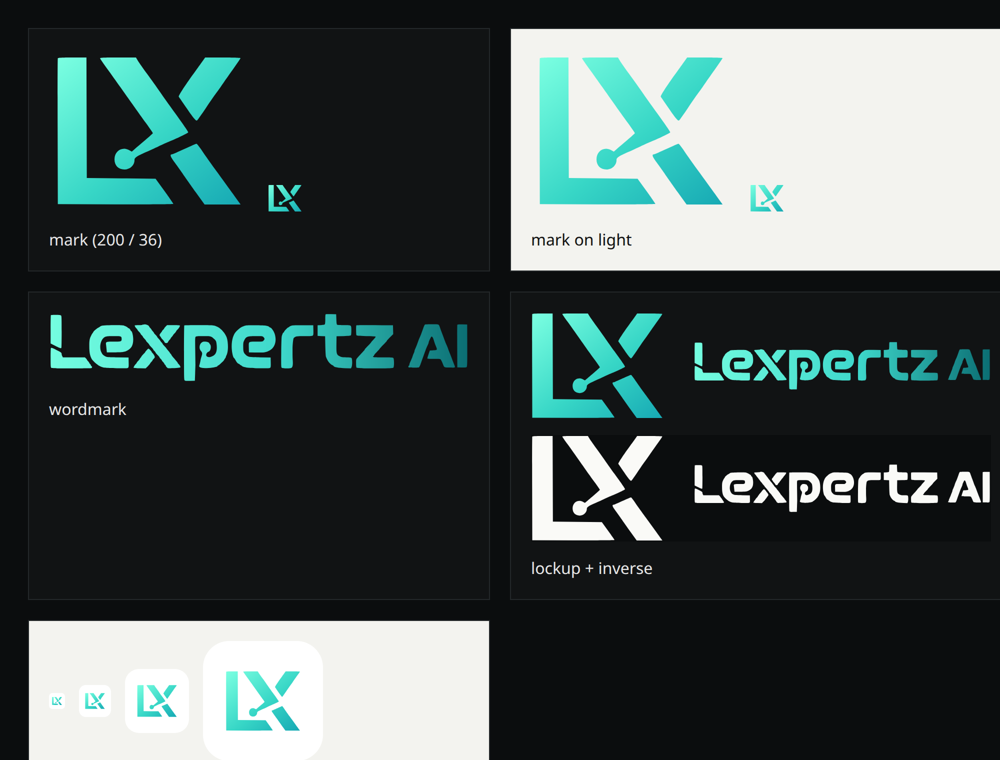
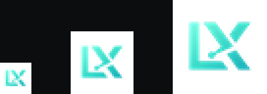

# Brand assets

The logo system is vector-first. Everything below is generated from the two
SVG masters; the raster files exist only for platforms that require them.

## Files

| File | Use |
|---|---|
| `public/brand/logo-mark.svg` | Primary mark. Nav, footer, social avatars, anywhere the brand is already named. |
| `public/brand/logo-wordmark.svg` | Wordmark only. Deck covers, email signatures, wide spaces. |
| `public/brand/logo-lockup.svg` | Mark + wordmark. Preferred when the brand name must be legible on its own (social cards, partner pages). |
| `public/brand/logo-lockup-inverse.svg` | Single-colour lockup for dark photography or one-colour print. |
| `public/brand/logo-lockup-1200.png` | Transparent 1200px lockup for tools that reject SVG. |
| `public/brand/logo-mark-512.png` | Transparent mark for schema.org and platform avatars. |
| `public/brand/logo-tile.svg` | Rounded app tile (white). Source for the favicon family. |
| `public/brand/logo-tile-*.png` | Opaque square tiles for PWA / home screen. |
| `src/app/favicon.ico` | Browser tab, 16/32/48 multi-size. |
| `src/app/icon.svg` | Modern browser tab (crisp at any DPI). |
| `src/app/apple-icon.png` | iOS home screen, 180px. |

## Rules

- **Size by height.** The mark is 283:232, not square. In code use
  `className="h-8 w-auto"` — never `h-8 w-8`, which stretches it.
- **Minimum sizes.** Mark: 16px tall (favicon) / 24px in UI. Lockup: 120px wide.
- **Clear space.** Keep half the mark's height free on every side. The SVG
  viewBox already includes a 10-unit margin.
- **Colour.** Do not recolour the gradient or place the gradient mark on a
  mid-tone background. Use the inverse lockup on photography and on brand-blue.
- **No effects.** No shadows, glows, strokes, or rotation.

## Sizes and context

| Context | Asset | Size |
|---|---|---|
| Browser tab | `favicon.ico` + `icon.svg` | 16/32/48 |
| iOS home screen | `apple-icon.png` | 180 |
| Android / PWA | `logo-tile-192.png`, `logo-tile-512.png` | 192, 512 |
| Site header | `logo-mark.svg` | 32px tall |
| Footer (brand-blue card) | `logo-lockup-inverse.svg` | 40px tall |
| Open Graph default | `public/og/default.png` | 1200×630 |
| schema.org logo | `logo-mark-512.png` | 512 |
| Decks / docs | `logo-lockup.svg` | ≥120px wide |

## Regenerating

The SVGs were vectorised from the original raster marks (`public/logo-icon.png`
and `public/logo-full.png` in git history). The mark traces cleanly because it
is geometric. The wordmark is a faithful trace, but its source was only 84px
tall — if a designer redraws the logotype, replace `logo-wordmark.svg` and
regenerate the lockup and PNG exports; nothing else references the letterforms.

Raster exports are rendered from the SVGs at 2× and downsampled (see
`src/app/favicon.ico` for the ICO bundle).
