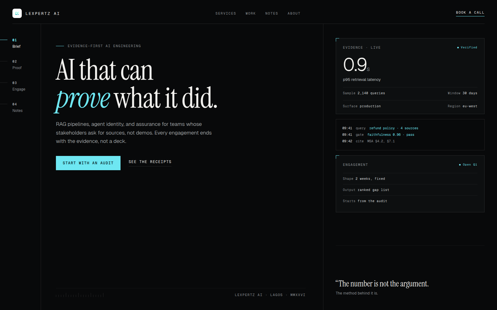
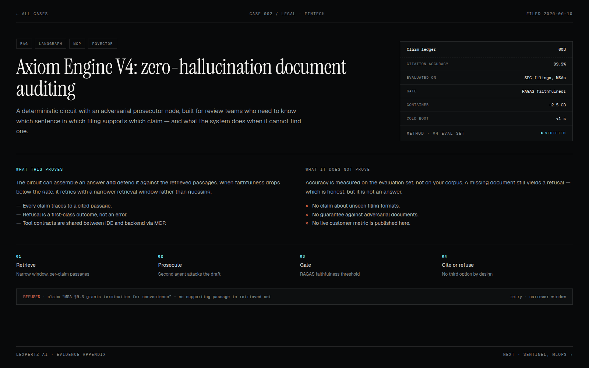

# Design upgrade proposal — "The Ledger"

Status: **proposal, not implemented.** Everything below is a direction for review.
The functional fixes from the 2026-11-04 review are already in the repo; this
document only covers the visual and interaction upgrade.



## 1. Where the site stands

The current system is a dark, tactile bento layout: near-black surfaces, a
cyan→blue gradient for primary actions, Space Grotesk headings, a pinned GSAP
hero, and an indigo card stack for services. The copy is the strongest asset —
specific, opinionated, and free of the usual AI-startup language.

The problem is a mismatch. The copy sells **evidence, auditability, and proof**.
The interface looks like a generic dark SaaS product: glow, gradient buttons,
floating phone mockups, and stock city lights. Nothing in the visual language
says "this vendor will show you the receipts." That gap is the upgrade.

## 2. The idea

Make the site behave like an **evidence instrument** rather than a landing page.

Four principles:

1. **Claims carry their provenance.** A number is never shown alone; it is
   attached to a sample, a method, a date, or a limit. This becomes a component,
   not a copy convention.
2. **Structure is visible.** Hairlines, index numbers, ticks, and mono labels
   are part of the design, not decoration. The page reads like a well-made
   technical document.
3. **One accent, used for meaning.** Cyan means *verified / interactive*. It is
   not used for ambient glow. Everything else is ink, paper, and hairline.
4. **Motion only where it carries meaning.** The hero keeps a short, purposeful
   sequence. Nothing else pins, parallaxes, or floats for effect.

The concept visuals in this folder are the target:

- [Homepage concept](assets/concept-hero.png)
- [Case study "receipt" concept](assets/concept-case.png)

## 3. Visual system changes

### Type

| Role | Now | Proposed |
|---|---|---|
| Display | Space Grotesk 700 | **Instrument Serif 400** (editorial, human, not another geometric sans) |
| Body/UI | Geist | Geist (unchanged) |
| Metadata | Geist Mono, rare | Geist Mono, **systematic**: labels, metrics, timestamps, stack lists |

The serif/mono pairing is the single highest-leverage change. It separates
"statement" from "measurement" and immediately stops looking like every other AI
site. Geist stays for body copy so the site does not become a magazine.

Concretely: add `Instrument_Serif` in `src/app/layout.tsx` as `--font-editorial`,
then map `font-display` in `tailwind.config.ts` to the serif and introduce
`font-editorial` for long-form statements. Headline sizes come down ~15% because
serif at 92px carries more than sans at 96px.

### Colour

Keep `#050506` as the floor. Remove the atmospheric mesh from every section and
re-introduce it only behind the hero. Add two surfaces:

- `--surface-ink` `#0b0d0e` — cards and panels
- `--surface-raised` `#121516` — hover and inset blocks

Keep `--brand-cyan` at its bright value for *interactive* states only (links,
focus, verified dots). Primary buttons become **solid cyan with ink text**
(contrast measured at 9.4:1) instead of a gradient with white text. The gradient
survives only in the logo-adjacent brand card, or is removed entirely.

### Grid and rhythm

Introduce an explicit 12-column desktop grid with visible **hairline guides** on
the homepage only (they fade below `lg`). Sections align to it. Every section
gets a mono index (`01 / BRIEF`) in a left rail that tracks scroll progress —
this replaces the current decorative "01, 02" counters with a real navigation
device that also works as a skip list for screen readers.

Spacing scale: tighten from the current generous `py-24`/`py-32` to
`py-20 lg:py-28`; the page is long and the whitespace is currently doing the
work that typography should be doing.

### Surfaces

- Corners: 2px on panels, 0 on buttons and tags. The current 12–32px radius
  reads "SaaS template".
- Borders: 1px `rgba(242,241,238,0.12)`, never shadows for hierarchy.
- Cards lose the gradient fill; a card is a hairline rectangle with a mono
  header row.

## 4. New components

| Component | Purpose | Replaces |
|---|---|---|
| `EvidenceCard` | A claim + value + sample + method + status | the floating "p95 latency" badge and loose stat cards |
| `ClaimLedger` | Table of metric / method / sample / verified | case-study `StatCard` row |
| `SectionIndex` | Sticky numbered rail with scroll progress | decorative counters |
| `RunLog` | 3–5 mono lines showing a real system trace | the fake phone mockup |
| `LimitsBlock` | "What this proves / what it does not" | nothing (new differentiator) |
| `Footnote` | Superscript + method note under a metric | nothing (new) |

`EvidenceCard` is the workhorse. Proposed API:

```tsx
<EvidenceCard
  label="p95 retrieval latency"
  value="0.9s"
  sample="2,140 queries · 30 days"
  method="production telemetry, eu-west"
  status="verified"
/>
```

Every instance of the current `StatCard` on the homepage and case studies maps
to this with no new content required — the data already exists in
`src/content/case-studies.ts`; it just needs a `method` field.

## 5. Page blueprints

### Homepage

1. **Brief** (above the fold, no pin): serif statement, one paragraph, two
   actions, and a live-looking evidence panel on the right. This is the concept
   image. The current 4,400px cinematic hero becomes an optional second beat, or
   is retired on mobile entirely.
2. **Proof**: 3–4 `EvidenceCard`s in a row, each with its method footnote. No
   "250+ pipelines" without a definition of what is counted.
3. **Engagements**: the four services as a numbered list (not a card stack),
   each expanding in place. Removes ~2,400px of scroll and the indigo palette
   that matches nothing else on the site.
4. **Receipts**: two case studies as mini claim ledgers, linking to the full
   receipt pages.
5. **Notes**: three insights, editorial layout, serif titles.
6. **Close**: one paragraph and one action. The roadmap map goes; it is
   decoration that implies a product timeline that does not exist.

Expected effect: page height drops from ~15,300px to ~7,000px at 1440px.

### Case study ("receipt")



- Mono masthead: case number, industry, filed date.
- Serif title + lede.
- **Claim ledger** on the right: every metric with its evaluation set.
- Two columns: *What this proves* / *What it does not prove*. Publishing limits
  is the differentiator; it is also what makes the other claims believable.
- Method strip: 4 steps, then a real refusal example in mono.
- No hero image. The ledger is the hero.

### Insights

Keep the current reading layout but move to serif titles, add a margin-note
column at `xl` for footnotes and source links, and a `Sources` block at the end.
Article schema already exists; add `citation` entries from frontmatter.

### Contact

Two-column: the form, and a short "what happens next" panel with the founder's
direct address and a one-business-day commitment. The form loses the gradient
button and gains the same hairline panel treatment.

## 6. Motion

- Hero: one sequence, ≤2,000px of scroll on desktop, 0 on mobile (static brief).
- Section entrances: 12px rise + opacity, 400ms, staggered 60ms, once.
- Hover: border colour and translate ≤2px. No scale.
- `prefers-reduced-motion`: static everything; the current CSS-swap approach in
  `hero-cinematic.tsx` is the pattern to keep.
- Delete GSAP if the pinned hero is retired; the rest can be CSS + Framer.

## 7. What stays

- All copy. It is the best part of the site.
- The dark base and the cyan accent (used differently).
- The case study content and insights pipeline.
- The logo mark and founder photography.
- The current routing, metadata helper, and structured data.

## 8. What I would not do

- No WebGL, no particle fields, no 3D device mockups.
- No glassmorphism beyond the single sticky nav.
- No fake product dashboards; `RunLog` must show a real trace or be omitted.
- No light mode until the hero and footer are designed for it.

## 9. Rollout

| Phase | Scope | Effort | Risk |
|---|---|---|---|
| 0 | Tokens: serif, colours, radii, hairlines; remove mesh | 0.5 day | Low |
| 1 | Homepage brief + `EvidenceCard` + `SectionIndex` | 2 days | Medium |
| 2 | Engagements list replaces card stack | 1 day | Low |
| 3 | Case study receipt layout + `method` data | 1.5 days | Low |
| 4 | Insights editorial layout + sources | 1 day | Low |
| 5 | Contact, footer, motion pass, a11y re-check | 1 day | Low |

Each phase is independently shippable; phase 0 alone changes the feel
substantially.

## 10. How we would know it worked

- Homepage scroll depth to the first service halves.
- Mobile bounce on `/` drops (currently the first screen has one action).
- Case-study page average time increases (the receipt gives people something to
  read).
- No WCAG AA regressions; the CTA contrast fix already in place is the floor.

## 11. Open questions

1. Is Instrument Serif the right voice, or should the display face stay
   geometric? (The serif is the boldest part of this proposal.)
2. Are the metrics in `case-studies.ts` defensible enough to publish a *method*
   beside each one? If not, phase 3 needs a content pass first.
3. Does the evidence panel on the homepage show live data, or a dated snapshot?
   A snapshot is safer and still credible.
